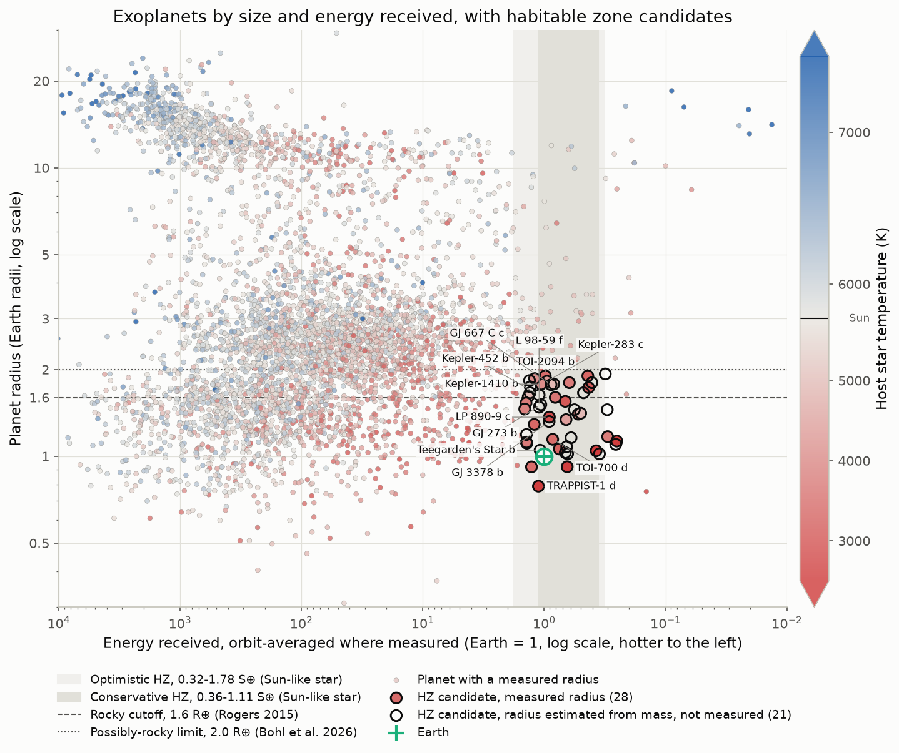
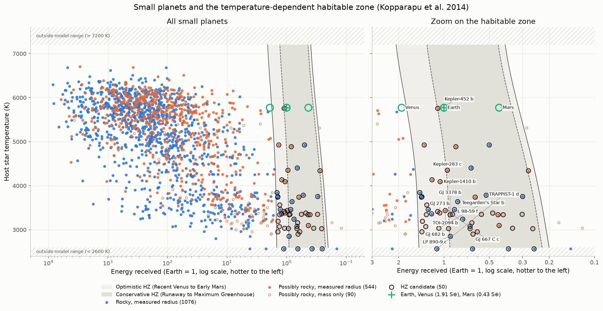
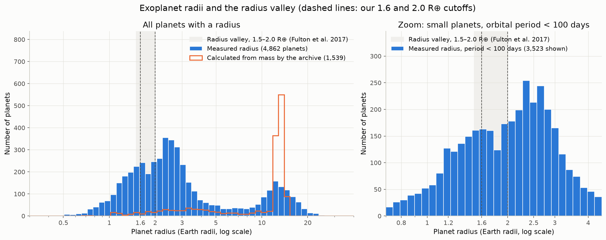
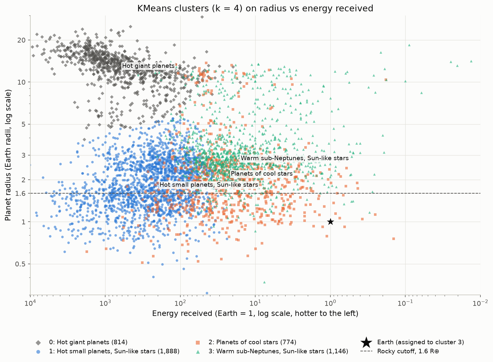

# Exoplanet Habitability

[](https://github.com/anshulsin15jn-boop/exoplanet-habitability/actions/workflows/tests.yml)
[](https://colab.research.google.com/github/anshulsin15jn-boop/exoplanet-habitability/blob/main/notebooks/exoplanet_habitability.ipynb)

This project uses data from the NASA Exoplanet Archive to find rocky exoplanets in the habitable zone of their stars. The habitable zone is the range of distances where a rocky planet with an Earth like atmosphere could keep liquid water on its surface. The results are compared with three NASA linked research sources: the Kopparapu et al. habitable zone model, the target star list for NASA's Habitable Worlds Observatory, and the published catalog of Bohl et al. (2026).

## Summary of findings

This project identified 50 small planets in the habitable zones of their stars using data from the NASA Exoplanet Archive. Of the 50 planets, 41 orbit stars cooler than 4000 K. The candidate list was compared with a published catalog of rocky planets in the habitable zone by Bohl et al. (2026). The two lists generally agree. This project recovered 42 of the 45 planets in the Bohl et al. catalog. Of the 50 candidates in this project, 42 appear in that catalog. None of the 50 candidates orbit a target star of NASA's planned Habitable Worlds Observatory, as those targets are bright nearby stars similar to the Sun. Unsupervised clustering placed Earth in a cluster made up mostly of warm planets between the sizes of Earth and Neptune that orbit stars similar to the Sun. However, Earth was farther from the center of that cluster than 97 percent of its members. This result likely reflects detection bias, as small planets on yearlong orbits around stars similar to the Sun are difficult to detect. Consistency checks showed that the archive's composite parameters table sometimes combines values from different papers that disagree. For two planets, the stellar flux was recomputed from internally consistent values, and one of these planets moved into the habitable zone. Being in the habitable zone does not confirm that a planet has an atmosphere or liquid water.

## Results

| Measure | Value |
|---|---|
| Planets in the archive snapshot (24 October 2026) | 6,451 |
| Planets with a measured radius / judged by mass only / excluded | 4,862 / 1,290 / 299 |
| Rocky or possibly rocky planets | 1,808 |
| Inside the Kopparapu (2014) optimistic zone, strict 2600 to 7200 K range | 46 |
| Candidates, including 4 TRAPPIST-1 planets flagged as just outside the model range | **50** |
| Candidates also inside the conservative zone | 27 |
| Candidates orbiting M dwarfs (below 4000 K) | 41 of 50 |
| Candidates within 50 light years | 25 (20 of them have no measured radius) |

**Comparison with Bohl et al. (2026)**, with their catalog treated as the answer key:

| Comparison | Precision | Recall | Precision without the 157 planets released after their download |
|---|---|---|---|
| Our 50 candidates vs their 45 rocky habitable zone planets | 0.840 | 0.933 | 0.875 |
| Our list using their boundaries (Kopparapu 2013) | 0.826 | 0.844 | 0.864 |
| Our 3D zone (interpolated from their printed limits) vs their 24 | 0.920 | 0.958 | 0.958 |

**NASA Habitable Worlds Observatory (HWO) target stars (164 stars):** matching by HIP and TIC catalog numbers finds known planets around 29 HWO stars. Matching by star name alone finds only 8, because the same star often has several names. None of our 50 candidates orbits an HWO target star.

**Earth Similarity Index (top 3):** TOI-700 d (0.926), TOI-700 e (0.910), and TRAPPIST-1 d (0.908). Every disagreement with Bohl et al. has a recorded reason in `outputs/comparison_table.csv`.

## Key figures

**Planet radius vs energy received.** Habitable zone candidates are ringed. Candidates without a measured radius are drawn hollow.



**The temperature dependent habitable zone.** Kopparapu et al. (2014) boundaries are drawn only where the model is valid (2600 to 7200 K).



**The radius valley.** Few planets have radii between about 1.5 and 2.0 Earth radii.



**KMeans clusters.** Four groups found without labels, with Earth marked.



## How to run

To run it in your browser, use the Open in Colab badge. The first notebook cell then downloads the project and installs what Colab is missing.

To run it locally, the requirements include Python 3.11 or newer and Git.

```
git clone <this repository>
cd exoplanet-habitability
python -m venv .venv
.venv\Scripts\activate            (on macOS or Linux: source .venv/bin/activate)
pip install -r requirements-lock.txt
python -m pytest
jupyter nbconvert --to notebook --execute notebooks/exoplanet_habitability.ipynb --output-dir outputs/_run
```

`requirements-lock.txt` pins the exact versions used (tested with Python 3.14 and pandas 3.1). `requirements.txt` gives looser minimum versions, and the notebook also runs on pandas 2.x, which is what Google Colab provides. All data is loaded from dated snapshots in `data/raw/`, so the notebook makes no network calls unless a snapshot is missing. A clean clone with a fresh environment reproduces every output byte for byte.

## Project layout

| Folder | Contents |
|---|---|
| `notebooks/` | `exoplanet_habitability.ipynb`, the full analysis in six phases |
| `src/` | Tested helper code for downloads, physics, habitable zones, rocky labels, clustering, comparison, and plotting |
| `tests/` | 57 pytest tests |
| `data/raw/` | Dated, unmodified snapshots from the NASA Exoplanet Archive and Zenodo |
| `data/processed/` | Cleaned tables and `flux_overrides.csv` (two corrected fluxes with sources and reasons) |
| `outputs/` | `hz_candidates.csv` and `comparison_table.csv` |
| `figures/` | All figures as PNG files |

## Method in brief

1. **Load.** The Planetary Systems Composite Parameters table (`pscomppars`) was downloaded through the archive's TAP service. This table has one row per planet.
2. **Classify.** Planets with a measured radius are rocky up to 1.6 Earth radii (Rogers 2015) and possibly rocky up to 2.0 (Bohl et al. 2026). Planets without a measured radius are judged by mass (possibly rocky up to 5 Earth masses). Masses that the archive computed from the radius are never used to support a rocky label.
3. **Energy.** Flux is computed as luminosity divided by the square of the orbital distance and averaged over the orbit when the eccentricity was measured. Habitable zone boundaries follow Kopparapu et al. (2013, 2014) and Ramirez and Kaltenegger (2018). Stars outside the model's temperature range are flagged instead of extrapolated.
4. **Cluster.** KMeans groups planets on radius, flux, orbital period (all in log form), and stellar temperature. Two similarity scores to Earth are computed, including the Earth Similarity Index.
5. **Compare.** The candidate list is compared with the Kopparapu model, the HWO target stars, and Bohl et al. (2026), and each disagreement receives a reason.

## Limitations

- Detection methods favor large planets on short orbits around small stars, so the known planets are not a fair sample of all planets.
- Radius alone does not show what a planet is made of. A planet of 1.5 Earth radii could be rocky, a water world, or rock with a thin gas layer. 21 candidates have no measured radius at all.
- Red dwarf stars flare often and can strip atmospheres. Planets in their habitable zones are likely tidally locked, with one side always facing the star.
- Being in the habitable zone does not show that a planet has an atmosphere or water.
- The composite archive table can combine values from different papers that disagree. Two such cases were corrected, and others may remain.
- Model choices move a few planets in or out. These include the habitable zone boundaries, the strict temperature range, and the rocky cutoffs. The 3D zone formula cited by Bohl et al. could not be reproduced from the published coefficients.
- The clustering agrees with the published list, but this agreement is not independent confirmation. Flux and stellar temperature define the habitable zone and were also clustering features.

## How this was built

I built this project with Claude Code as a pair programmer. I made the scientific decisions at each phase. These decisions include excluding microlensing planets, never using a mass computed from a radius to confirm a rocky label, applying a strict model temperature range, keeping the four TRAPPIST-1 planets as flagged candidates, setting aside only planets released after the Bohl et al. download, and correcting two fluxes with internally consistent values rather than adopting published values from the comparison catalog.

## License

The code in this repository is released under the MIT License (see `LICENSE`). The data files keep their original terms, including the NASA Exoplanet Archive's terms for archive data and CC BY 4.0 for the Bohl et al. files.

## Data sources and acknowledgments

This research has made use of the NASA Exoplanet Archive, which is operated by the California Institute of Technology, under contract with the National Aeronautics and Space Administration under the Exoplanet Exploration Program.

- NASA Exoplanet Archive: Christiansen, J. L., et al. (2025), *The Planetary Science Journal*, https://doi.org/10.3847/PSJ/ade3c2. Planetary Systems Composite Parameters table, https://doi.org/10.26133/NEA13, accessed 24 October 2026. The `ps` table and the HWO ExEP Precursor Science Stars table (`DI_STARS_EXEP`) were accessed through the TAP service on the same date.
- Bohl, A., Lawrence, L., Lowry, G., and Kaltenegger, L. (2026). CSV Files for "Probing the Limits of Habitability: A Catalog of Rocky Exoplanets in the Habitable Zone" [Data set]. Zenodo. https://doi.org/10.5281/zenodo.18134528. Licensed under CC BY 4.0 (https://creativecommons.org/licenses/by/4.0/). The files `Table1_rocky_HZ_Gaia_NEA.csv` and `All_HZ_Gaia_NEA.csv` are stored unmodified in `data/raw/`, renamed with their download date.
- Bohl, A., et al. (2026), *Monthly Notices of the Royal Astronomical Society*, https://doi.org/10.1093/mnras/stag028 (arXiv:2501.14054).

**Other references:** Chen and Kipping (2017), Dabhade et al. (2025, arXiv:2512.00899, Earth Similarity Index), Fulton et al. (2017, AJ 154, 109), Kopparapu et al. (2013, ApJ 765, 131), Kopparapu et al. (2014, ApJL 787, L29), Ramirez and Kaltenegger (2018, ApJ 858, 72), Rogers (2015, arXiv:1407.4457), Schulze-Makuch et al. (2011, Astrobiology 11, 1041), Williams and Pollard (2002), Bolmont et al. (2016, A&A 591, A106), and the IAU 2015 Resolution B3 nominal solar values.
